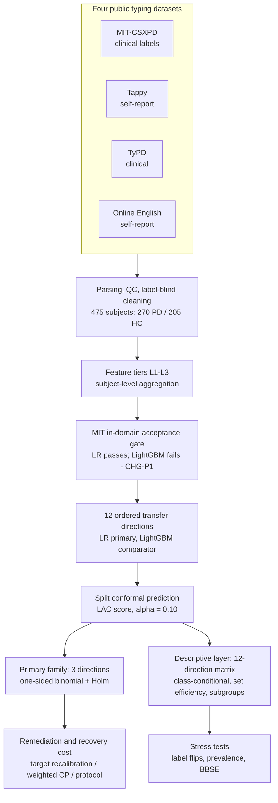
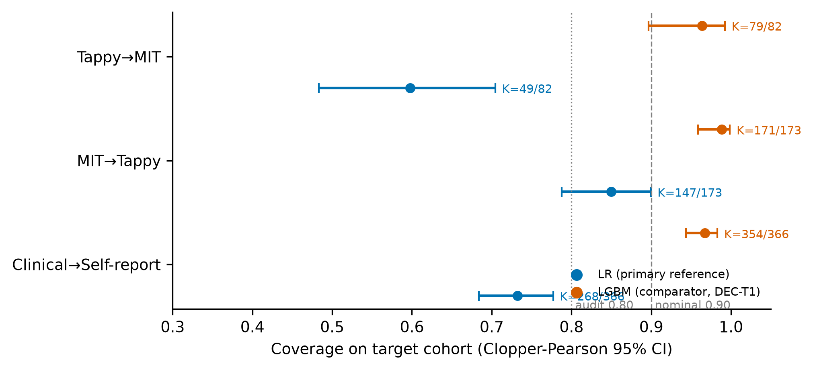
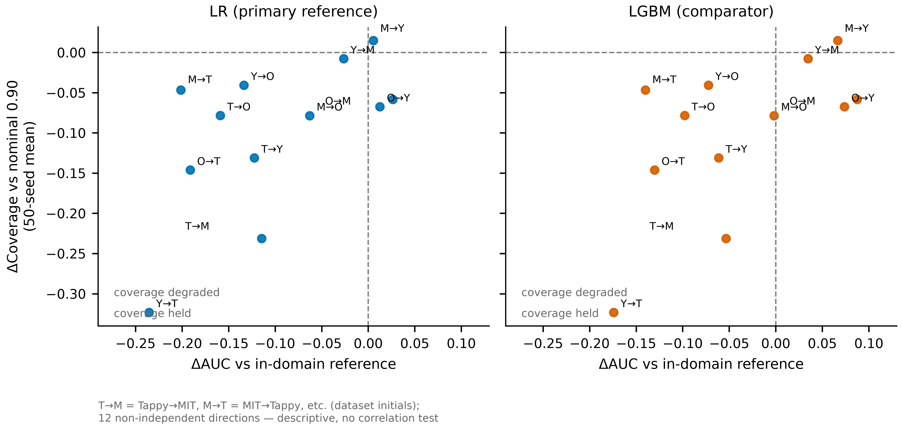

# typing-pd-conformal-audit

**Cross-dataset conformal coverage audit of PD typing classifiers under deployment shift**

[](LICENSE)
[](https://www.python.org/)
[](https://github.com/Tiannn0512/typing-pd-conformal-audit/releases/tag/v1.0)
[](https://osf.io/j9fvx)

This repository contains the analysis code, frozen results, and governance
documents for a pre-registered audit of split-conformal prediction coverage
when keystroke-based Parkinson's disease (PD) classifiers are deployed across
typing datasets. Four public datasets give 12 ordered transfer directions;
three pre-specified primary directions carry confirmatory one-sided binomial
tests (H0: true coverage ≥ 0.90) under Holm control. All three were
Incompatible with nominal coverage.

> **Code availability.** [`v1.0`](https://github.com/Tiannn0512/typing-pd-conformal-audit/releases/tag/v1.0)
> is the release snapshot of the frozen analysis. The full development history,
> including the pre-registration tag `v1.0-prereg` and the result-freeze tag
> `results-frozen-v1`, is preserved on the [`archive/dev-history`](https://github.com/Tiannn0512/typing-pd-conformal-audit/tree/archive/dev-history) branch.

---

## Table of Contents

- [Introduction](#introduction)
- [Audit Design](#audit-design)
- [Main Results](#main-results)
- [Repository Structure](#repository-structure)
- [Installation](#installation)
- [Usage](#usage)
- [Governance](#governance)
- [Citation](#citation)
- [Acknowledgements](#acknowledgements)
- [Data Availability](#data-availability)
- [License](#license)

---

## Introduction

Keystroke dynamics is an established digital marker for PD screening, and
public datasets have supported a decade of classifier development. Evaluation
of these classifiers is dominated by discrimination metrics such as the AUC.

This study asks a second question: after a classifier and its calibration set
are transported to a new dataset, does its prediction-set coverage still hold
at the nominal level? Conformal prediction provides prediction sets with a
marginal coverage guarantee under exchangeability between calibration and
target data — an assumption that cross-dataset deployment cannot take for
granted. The audit measures what actually happens, direction by direction.

### Key contributions

1. **A pre-registered coverage audit** across 12 ordered transfer directions
   between four public typing datasets, with confirmatory tests on three
   primary directions.
2. **Discrimination–coverage decoupling**: AUC and conformal coverage did not
   move together; a comparator with lower AUC on all 12 directions held higher
   marginal coverage on 11 of them.
3. **Class-conditional failure structure**: marginal totals concealed
   class-conditional collapse, and the failing class differed across target
   cohorts.
4. **Recovery-cost quantification**: how many target labels (or how much
   prediction-set efficiency) each direction needs to restore coverage.

## Audit Design



The confirmatory analysis uses a single pre-registered calibration split
(seed 1 of 50); 50-seed summaries are descriptive. Discrimination carries no
inferential role; the direction-level joint reading of AUC and coverage is
pre-specified as descriptive.

## Main Results

Primary family (α = 0.10, split CP, confirmatory seed, Holm-adjusted p):

| Direction | Coverage [95% CI] | Adjusted p | Verdict |
|---|---|---|---|
| Tappy→MIT | 0.598 [0.483, 0.704] | 1.2×10⁻¹² | Incompatible |
| MIT→Tappy | 0.850 [0.788, 0.899] | 0.023 | Incompatible |
| Clinical pool→self-report | 0.732 [0.684, 0.777] | 2.5×10⁻¹⁹ | Incompatible |

Further findings from the frozen layer:

- **Discrimination–coverage decoupling.** Across the 12 directions, AUC
  (0.55–0.81) and coverage (0.58–0.91) showed no synchronous pattern; the
  LightGBM comparator, with lower AUC on all 12 directions, held higher
  marginal coverage on 11 — paid for with larger prediction sets.
- **Class-conditional collapse.** In Tappy→MIT, PD-conditional coverage was
  0.214 while HC-conditional coverage was 1.000; the failing class differed
  across target cohorts.
- **Recovery is direction-dependent.** 9 and 18 target labels restored two
  directions past the 0.80 audit threshold; the worst direction did not reach
  it within a 30% budget, and its PD-conditional gap persisted. Label-free
  density-ratio weighting reached nominal coverage only by abstaining on
  86–100% of subjects.
- **Stress tests.** Synthetic label flips produced one-sided class-conditional
  collapse, but no tested mechanism reproduced the observed pattern within
  pre-set tolerances; BBSE rejected pure label shift for the worst direction
  (estimate 0.000 vs observed 0.512).





## Repository Structure

```
├── README.md                          # This file
├── LICENSE                            # MIT
├── requirements.txt                   # Pinned Python dependencies
├── run_all.py                         # Pipeline entry: 23 stages, --run / --from
├── src/
│   ├── data/                          # Dataset parsers, QC, schema validation
│   ├── features/                      # Feature tiers L1-L3, cohort tables
│   ├── models/                        # Shared fitting, baseline, transfer pipeline
│   ├── cp/                            # Conformal audit: primary family,
│   │                                  #   class-conditional, remediation,
│   │                                  #   stress tests, BBSE, sensitivity, subgroups
│   ├── protocol.py                    # Effective registered settings
│   ├── runtime.py                     # Configuration and reference paths
│   └── power_sim.py                   # Pre-registered power simulation
├── scripts/
│   ├── make_figures.py                # Publication figures from frozen CSVs
│   ├── make_tables.py                 # Paper tables from frozen CSVs
│   ├── mapie_crosscheck.py            # Split-CP cross-check vs MAPIE
│   └── overlap_priority_compare.py    # Verdict-rule overlap simulation
├── results/                           # Published reference tables
│   └── paper_tables/                  # Camera-ready tables, derived programmatically
├── figures/                           # Publication figures (600 dpi)
├── docs/
│   ├── analysis_plan_v1.md            # OSF-registered analysis plan
│   ├── 分析冻结协议_v1.md              # Analysis freeze protocol (Chinese)
│   ├── PROVENANCE.md                  # Commit chain and governance tags
│   ├── osf_doi.txt                    # OSF registration record
│   ├── changelogs/                    # Post-freeze change logs
│   └── supplementary/                 # Supplementary Tables S1-S3
├── configs/                           # Registered seeds, cleaning rules, feature tiers
├── tests/                             # Core, schema and reproduction regression tests
└── data/raw/DATA_MANIFEST.md          # Dataset sources and SHA-256 checksums
```

## Installation

```bash
git clone https://github.com/Tiannn0512/typing-pd-conformal-audit.git
cd typing-pd-conformal-audit
pip install -r requirements.txt
```

**Requirements:** Python 3.12. No GPU needed; the full pipeline runs on CPU.

## Usage

### 1. Data preparation

Raw data is not redistributed. Obtain the four public datasets and place them
under `data/raw/` following `data/raw/DATA_MANIFEST.md` (sources and SHA-256
checksums). Tappy requires registration; TyPD requires an application.

### 2. Run the pipeline

```bash
python run_all.py
python run_all.py --run --data-dir /path/to/prepared/raw --output-dir runs/reproduction
python run_all.py --run --from cp.coverage_audit --output-dir runs/reproduction
```

The first command prints the 23-stage plan. The second executes it in a new workspace; the third resumes an existing workspace whose earlier stages completed. Prepared inputs follow the directory structure in `data/raw/DATA_MANIFEST.md`.

Stages follow their data dependencies: parsing → schema checks → cleaning and cohort tables → L2/L3 features → QC report → baseline → transfer → conformal analyses → power → tables and figures. The baseline records the original LightGBM gate outcome and continues under the approved CHG-P1 choice of logistic regression. `train_baseline.py --gate-mode historical` retains the original nonzero exit on a failed LightGBM gate.

A workspace contains `data/`, `results/`, `figures/`, `models/`, stage logs and `run.json`. The runner snapshots the reference tables separately in `reference/`, records the effective configuration and environment, and compares generated CSVs with those references. Numeric cells use absolute tolerance `1e-9`; text, table structure and row order must match. Differences or missing reference tables produce a nonzero exit and remain available in the workspace for inspection. Existing output directories require `--from` to resume; code, configuration and input changes require a new run.

`results/` in this repository contains the published reference tables. All pipeline writes go to the selected workspace. Lower-level analysis scripts use paths relative to their working directory; run them from a workspace when inspecting an individual stage.

### 3. Tests and cross-checks

```bash
python -m pytest tests/          # unit tests
python scripts/mapie_crosscheck.py --output-dir runs/mapie-check
```

### 4. Reproducing the manuscript tables and figures

| Manuscript item | Source |
|---|---|
| Table 1 (cohorts) | `results/cohort_flow.csv`, `results/paper_tables/table1_cohort_flow.csv` |
| Table 2 (primary family) | `results/primary_family.csv` |
| Table 3 (sensitivity) | `results/paper_tables/table6_sensitivity.csv` |
| Figures 1-7 | `scripts/make_figures.py` (from frozen CSVs) |
| Supplementary Table S1 (cleaning attrition) | `results/cohort_flow.csv` → `docs/supplementary/` |
| Supplementary Table S2 (12-direction audit matrix) | `results/transfer_matrix.csv` → `docs/supplementary/` |
| Supplementary Table S3 (power analysis) | `results/power_table*.csv` → `docs/supplementary/` |

All numbers in the manuscript are derived programmatically from the frozen
CSVs — no hand-copied values.

## Governance

- The analysis plan was frozen and OSF-registered
  (`docs/analysis_plan_v1.md`, `docs/分析冻结协议_v1.md`, `docs/osf_doi.txt`;
  registration effective 2026-09-26, embargoed, reviewers get read access)
  before any cross-dataset coverage was computed. Development tag
  `v1.0-prereg`.
- Results were frozen at commit `ce26f33` (2026-09-27), tag
  `results-frozen-v1`. Later changes are append-only, recorded in
  `docs/PROVENANCE.md` and `docs/changelogs/`.
- The primary model was switched from LightGBM to logistic regression by a
  registered amendment (CHG-P1) after LightGBM failed the pre-specified
  acceptance gate (MIT in-domain, 50 seeds, AUC within 0.75-0.91); the three
  gate runs are kept in `results/baseline_mit_*.csv`.
- This branch contains the public release and subsequent maintenance commits; the full development history
  (both governance tags) is preserved on the `archive/dev-history` branch.

## Citation

If you use this code, please cite:

```bibtex
@software{typingpd_conformal_audit_2026,
  title  = {typing-pd-conformal-audit: cross-dataset conformal coverage audit
            of PD typing classifiers under deployment shift},
  author = {Tiannn0512},
  year   = {2026},
  url    = {https://github.com/Tiannn0512/typing-pd-conformal-audit},
  note   = {Version 1.0. Pre-registered analysis plan archived on OSF
            (registration Sep 26, 2026, embargoed)}
}
```

## Acknowledgements

- **PhysioNet** for the MIT-CSXPD (neuroQWERTY) and Tappy keystroke datasets
- **i-PROGNOSIS consortium** for the TyPD DS2.5 release (Zenodo record 2571623)
- The authors of the Online English typing dataset (OSF ew34b)
- **MAPIE** for the distribution-free uncertainty library used in the
  implementation cross-check

## Data Availability

The study uses four public datasets; no data files are redistributed in this
repository (only the manifest with sources and SHA-256 checksums):

| Dataset | Access | Labels |
|---|---|---|
| MIT-CSXPD (PhysioNet nqmitcsxpd 1.0.0) | open | clinical |
| Tappy (PhysioNet tappy 1.0.0) | registration | self-report |
| TyPD / i-PROGNOSIS DS2.5 (Zenodo 2571623) | application | clinical |
| Online English (OSF ew34b) | open | self-report |

## License

Code is released under the [MIT License](LICENSE). The four source datasets
keep their own terms and are not redistributed here.
