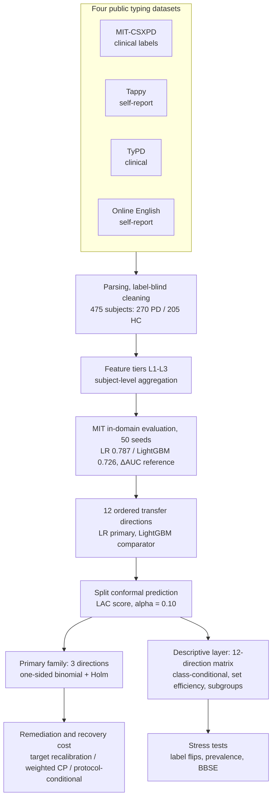

# typing-pd-conformal-audit

**Cross-dataset conformal coverage audit of PD typing classifiers under deployment shift**

[](LICENSE)
[](https://doi.org/10.5281/zenodo.23553162)

This repository contains the analysis code for an audit of split-conformal prediction coverage
when keystroke-based Parkinson's disease (PD) classifiers are deployed across
typing datasets. Four public datasets give 12 ordered transfer directions;
three primary directions carry confirmatory one-sided binomial
tests (H₀: true coverage ≥ 0.90) under Holm control. All three were
incompatible with nominal coverage.

---

## Table of Contents

- [Introduction](#introduction)
- [Audit Design](#audit-design)
- [Main Results](#main-results)
- [Repository Structure](#repository-structure)
- [Installation](#installation)
- [Usage](#usage)
- [Citation](#citation)
- [Acknowledgements](#acknowledgements)
- [License](#license)

---

## Introduction

Keystroke dynamics is an established digital marker for PD screening, and
public datasets have supported a decade of classifier development. Evaluation
of these classifiers is dominated by discrimination metrics such as the AUC.

This study asks a second question: after a classifier and its calibration set
are transported to a new dataset, does its prediction-set coverage still hold
at the nominal level? Conformal prediction provides prediction sets with a
marginal coverage guarantee under exchangeability between calibration and
target data, an assumption that cross-dataset deployment cannot take for
granted; the audit measures coverage direction by direction.

### Key contributions

1. **A coverage audit** across 12 ordered transfer directions
   between four public typing datasets, with confirmatory tests on three
   primary directions.
2. **Discrimination–coverage decoupling**: AUC and conformal coverage did not
   move together; a comparator with lower AUC on all 12 directions held higher
   marginal coverage on 11 of them.
3. **Class-conditional failure structure**: marginal totals concealed
   class-conditional collapse, and the failing class differed across target
   cohorts.
4. **Recovery-cost quantification**: how many target labels (or how much
   prediction-set efficiency) restoring coverage costs in each direction.

## Audit Design



The confirmatory analysis uses a single fixed calibration split
(seed 1 of 50); 50-seed summaries are descriptive. Discrimination carries no
inferential role; the direction-level joint reading of AUC and coverage is
descriptive.

## Main Results

Primary family (α = 0.10, split CP, confirmatory split, Holm-adjusted p):

| Direction | Coverage [95% CI] | Adjusted p | Verdict |
|---|---|---|---|
| Tappy→MIT | 0.598 [0.483, 0.704] | 1.2×10⁻¹² | Incompatible |
| MIT→Tappy | 0.850 [0.788, 0.899] | 0.023 | Incompatible |
| Clinical pool→self-report | 0.732 [0.684, 0.777] | 2.5×10⁻¹⁹ | Incompatible |

Further findings:

- **Discrimination–coverage decoupling.** Across the 12 directions, AUC
  (0.55–0.81) and coverage (0.58–0.91) did not move together; the
  LightGBM comparator, with lower AUC on all 12 directions, held higher
  marginal coverage on 11, paid for with larger prediction sets.
- **Class-conditional collapse.** In Tappy→MIT, PD-conditional coverage was
  0.214 while HC-conditional coverage was 1.000; the failing class differed
  across target cohorts.
- **Recovery is direction-dependent.** 9 and 18 target labels brought two
  directions past the 0.80 audit threshold; the worst direction did not reach
  it within a 30% budget, and its PD-conditional gap persisted. Label-free
  density-ratio weighting reached nominal coverage only by rejecting on
  86–100% of subjects.
- **Stress tests.** Synthetic label flips produced one-sided class-conditional
  collapse, but no tested mechanism reproduced the observed pattern within
  tolerances; BBSE rejected pure label shift for the worst direction
  (estimate 0.000 vs observed 0.512).

## Repository Structure

```
├── README.md                          # This file
├── LICENSE                            # MIT
├── run_all.py                         # Pipeline entry: 19 stages, --run / --from
├── src/
│   ├── data/                          # Dataset parsers
│   ├── features/                      # Feature tiers L1-L3, cohort tables
│   ├── models/                        # In-domain baseline, transfer pipeline
│   ├── cp/                            # Conformal audit: primary family,
│   │                                  #   class-conditional, remediation,
│   │                                  #   stress tests, BBSE, sensitivity, subgroups
│   └── power_sim.py                   # Power simulation
└── configs/                           # analysis.yml (seeds, tiers), cleaning.yml, key_hand_mapping.yml
```

## Installation

```bash
git clone https://github.com/haotian-bio/typing-pd-conformal-audit.git
cd typing-pd-conformal-audit
pip install numpy pandas pyarrow pyyaml scikit-learn scipy lightgbm
```

**Requirements:** CPU only.

## Usage

### 1. Data preparation

Raw data is not redistributed. Obtain the four public datasets and place them under
`data/raw/` as follows, verifying against the official checksums. Tappy requires
PhysioNet registration; TyPD requires an application.

| Dataset | Source | Place under `data/raw/` | Verify |
|---|---|---|---|
| Tappy | PhysioNet tappy 1.0.0 | `tappy/Archived-Data.zip` (89,176,393 B) + `Archived-users.zip` (73,032 B) + official `SHA256SUMS.txt`; user labels extracted to `tappy/Archived-users-extracted/` (227 txt) | zip SHA256 `d5fb550625211deed5a712705316bb4c79593d752f8403d9dc25e58c8230e580` / `a15f5eeac9004aaba0aa3c31b81d791256b6012bc8ae64f6fc556cd607df77fd` |
| MIT-CSXPD | PhysioNet nqmitcsxpd 1.0.0 | `mit/MIT-CS1PD/` + `mit/MIT-CS2PD/` (per-session CSVs, `GT_DataPD_*.csv`, `nqDataLoader.py`) | 121/121 files pass `sha256sum -c` against the official SUMS; gold anchor `GT_DataPD_MIT-CS1PD.csv` = 3,248 B |
| TyPD (i-PROGNOSIS DS2.5) | Zenodo record 2571623 | `typd/typd.zip` (365,931 B), extracted to `typd/extracted` | md5 `54be254f9194789102ab4e279cff2182` (Zenodo API) |
| Online English | OSF ew34b (CoNLL 2020) | `oe/CoNLL_2020_Online_English.csv` | 125,426,343 B; SHA256 `db2166b5211b359c0bea4fb3057d8a41fecfbc98057fdc23c2f8fbe946984403` |

### 2. Run the pipeline

```bash
python run_all.py                             # print the 19-stage plan
python run_all.py --run                       # end-to-end
python run_all.py --from cp.coverage_audit    # resume from a stage
```

Stages run in dependency order: parsing → features → cohort →
in-domain baseline → transfer → conformal audit → class-conditional → remediation →
calibration comparison → stress tests → BBSE → sensitivity → subgroups →
power. Stage commands use module defaults, which equal the fixed
settings; module-level asserts reject deviations (arm lists,
doses, strata, prevalence constants).

## Citation

If you use this code, please cite:

```bibtex
@software{typingpd_conformal_audit_2026,
  title  = {typing-pd-conformal-audit: cross-dataset conformal coverage audit
            of PD typing classifiers under deployment shift},
  author = {Guang, Haotian},
  year   = {2026},
  url    = {https://github.com/haotian-bio/typing-pd-conformal-audit}
}
```

## Acknowledgements

- **PhysioNet** for the MIT-CSXPD (neuroQWERTY) and Tappy keystroke datasets
- **i-PROGNOSIS consortium** for the TyPD DS2.5 release (Zenodo record 2571623)
- The authors of the Online English typing dataset (OSF ew34b)

## License

Code is released under the [MIT License](LICENSE). The four source datasets
keep their own terms and are not redistributed here.
