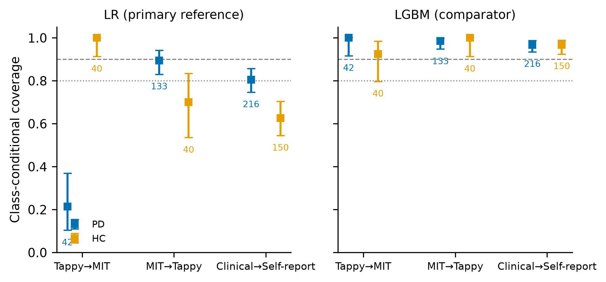
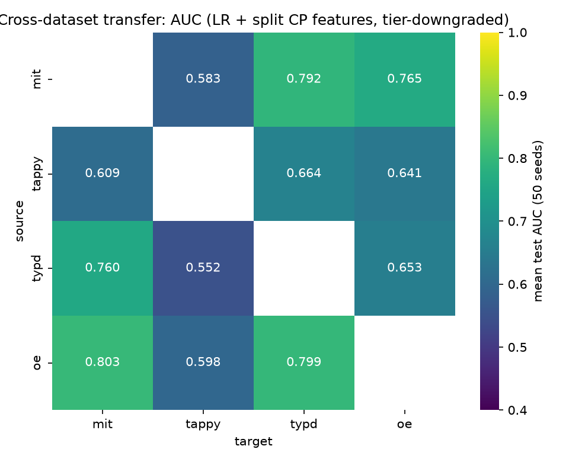
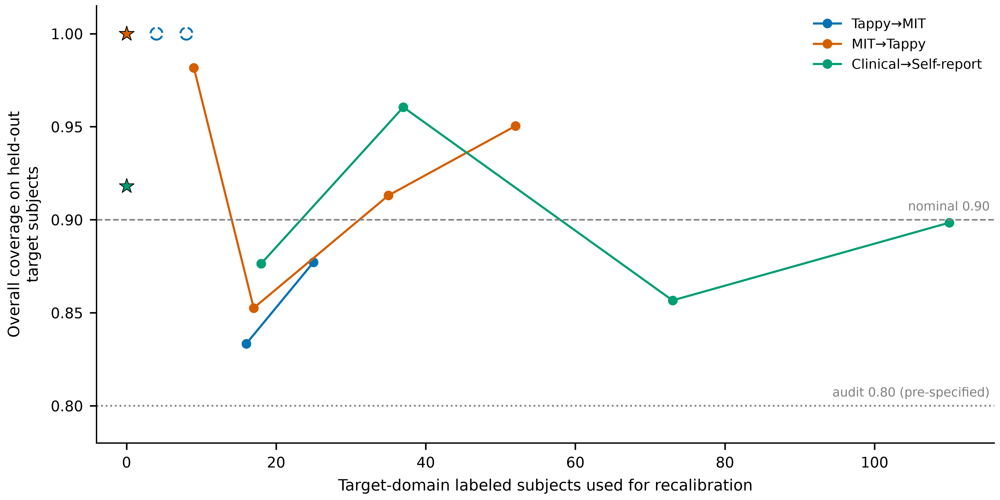
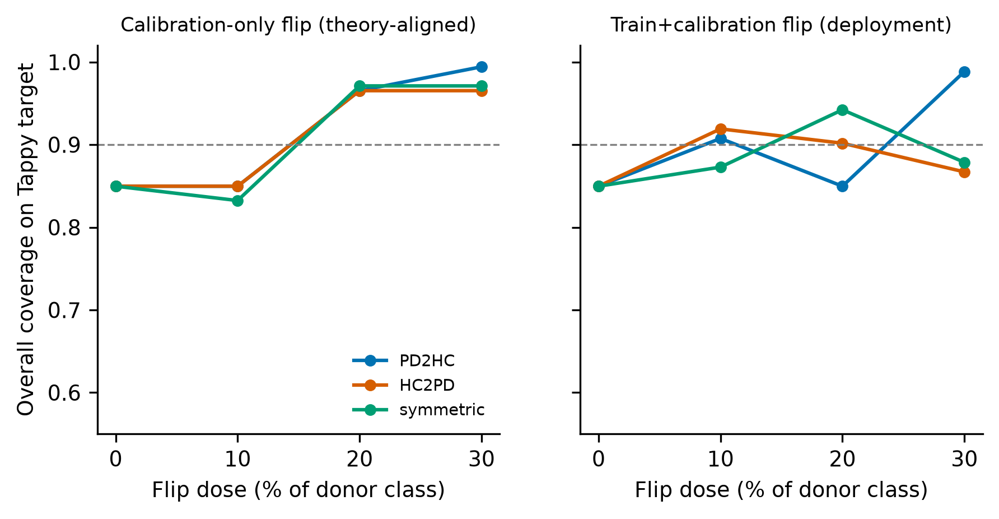

# 跨数据集部署下帕金森打字分类器的分数依赖型共形覆盖：一项预注册的四数据集审计

**中文版初稿（Journal of Medical Systems — Research article；与英文版 manuscript_joms_v0.9.md 对应，仅供作者与内部审稿使用；投稿以英文版为准）**
初稿 v0.9-JOMS-zh ｜ 2026-09-27 ｜ 数字来源：冻结标签 `results-frozen-v1`

> **标题页（提交前由作者补全）**
> 作者：Taylor [姓名]；单位：[院系，机构，城市，国家]；ORCID：[待填]；通信邮箱：[待填]
> **LLM 使用披露（期刊要求，请作者核实补全）：** 本研究的数据库管道执行、代码生成与内部一致性审计在人工指导下使用了 AI 智能体（ZCode CLI，GLM 模型）；全部输出经作者核验，作者对所有内容（含引文）负责。工具/版本/日期于投稿时填写。

**关键词：** 共形预测；帕金森病；打字动力学；覆盖审计；跨数据集部署；不确定性量化

**报告清单：** TRIPOD+AI 清单需填写后作为补充材料上传。分析协议在任何跨数据集覆盖数字算出之前已在 OSF 预注册（保密期 2 年；分析计划 v1，冻结标签 `v1.0-prereg`）。

---

## 摘要

背景：共形预测（CP）提供分布无关的预测集合，在可交换性下保证边际覆盖率。在基于打字动力学的帕金森病（PD）检测中，跨数据集部署会降低判别力，但覆盖保证在部署偏移下的命运从未被实证审计。方法：在预注册协议下，我们审计了分类器从一个公开打字数据集训练、部署到另一个数据集时的 split-CP 覆盖率（α = 0.10；LAC 分数；逻辑回归参照模型），涉及四个公开数据集（冻结队列：475 名受试者）。预注册主终点家族覆盖三个高效力的迁移方向，采用 Holm 校正。PD/HC 类条件覆盖为预先设定的安全性诊断。恢复（目标域校准预算）与归因（患病率重采样与标签翻转应力测试，对照预设实用容差）为预注册的次要分析。结果：三个主方向全部不相容（家族受控）：Tappy→MIT 0.598 [95% CI 0.483–0.704]，MIT→Tappy 0.850 [0.788–0.899]，临床池→自报 0.732 [0.684–0.777]。边际总量掩盖了极端的类别不对称（Tappy→MIT 的 PD 类条件覆盖 0.214，HC 为 1.000）。覆盖退化呈分数依赖性：判别力更低的 LightGBM 对照模型在所有主方向上维持 0.925–1.000 的类条件覆盖。两个方向恢复需 9–18 个目标域标注，但 Tappy→MIT 在 30% 预算内未能恢复；无标注的加权 CP 仅靠对 86–100% 受试者弃权实现覆盖。患病率重配与标签腐蚀无论单独还是叠加均未能复现观察到的表型。结论：在部署偏移下，判别力与覆盖表现为两个不同的可靠性维度；面向部署的报告应在 AUC 之外纳入覆盖审计与类条件诊断。

---

## 引言

打字动力学为帕金森病筛查提供了可扩展的数字生物标志物，公开数据集支撑了十年以判别力为唯一评价货币的分类器研发——典型指标是跨数据集迁移下的 AUC，其退化已被充分记录。一个已部署的筛查系统必须交付第二种性质：校准的不确定性。共形预测承诺这一点——在可交换性下，split CP 以至少 1−α 的概率覆盖真实标签，与底层模型无关——但跨数据集部署破坏了可交换性，且现实临床数据偏移下 CP 覆盖的行为研究多停留在理论或医学之外。据我们所知，这是首个对公开帕金森打字数据集上的共形预测覆盖率进行系统性实证审计的工作。

本审计刻画判别力退化与覆盖退化在部署偏移下是否呈现非同一模式（预注册假设 H1）。我们报告三条预注册证据表明它们确实不同：主终点家族的覆盖判定一致为负而判别力保持中等；判别力更低的对照模型展现出更高的覆盖率——覆盖失败是分数依赖的，而非任务偏移本身的属性；以形式上重现类条件崩塌的受控标签操纵，在量级上无法重现观察到的表型。我们将本工作报告为映射可靠性审计而非失败声明：预注册的判定词汇表达的是与预设运营审计阈值的统计相容性，而非临床失败，且主结果不以观察到退化为条件。

研究贡献：(i) 对四个公开 PD 打字数据集的 CP 覆盖率进行预注册、保密期的系统性审计，含冻结队列与家族受控主终点；(ii) 覆盖–判别解耦图谱：全部 12 个有序迁移方向 × 两个分数函数的六元组；(iii) 异质标签来源（临床 vs 自报）对覆盖行为影响的在野量化，含受控偏移应力测试；(iv) 开放审计工具包（三档特征体系、覆盖复原单元测试含 weighted CP 独立 oracle、预注册协议、覆盖→工作流映射：单例=自动通过，双例=人工复核，全集=系统拒绝）。

## 方法

### 数据与队列
四个公开数据集：MIT-CSXPD（临床金标准）、Tappy Keplar（自报、自带设备）、TyPD（临床，i-PROGNOSIS）、Online English（自报，网页端）。清洗规则预注册且标签盲（七步，如会话有效 digraph ≥100、人资格 ≥300）。冻结队列 475 人（PD 270 / HC 205）：MIT 82（42/40）、Tappy 173（133/40）、TyPD 27（12/15）、OE 193（83/110）。PD 定义：临床诊断字段（MIT、TyPD）或自报字段（Tappy、OE）。三名报告震颤但无 PD 诊断的 Tappy 参与者被主分析排除；双向重纳入作为敏感性分析报告。本研究仅使用去标识化的公开数据集，未收集新的人体数据。

### 特征与模型
人级特征聚合个人全部有效 digraph（一名受试者 = 一个共形观测）。三个预注册特征档——L1：hold/latency/flight 分布摘要（15 特征，全部数据集）；L2：手别条件摘要（MIT/Tappy/OE）；L3：digraph 转移特征（MIT/OE）——迁移档位固定为链路各数据集上限的最小值，并作为审计协变量记录。有效主参照模型为 L2 正则化逻辑回归（修正 CHG-P1：原定的 LightGBM 在三次留档运行中未通过预声明的库内 gate，按浅树设置作为对照报告）。全部超参数在接触目标数据前固定；目标数据集从未用于模型选择。

### 共形程序
Split CP 使用 LAC 分数（1 − 真类概率）、源队列 30% 分层校准切分（单一确证性 seed = 1，即登记种子首位；50-seed 汇总仅作描述）、α = 0.10、有限样本分位 k = ⌈(n+1)(1−α)⌉。四要素：预测器 = 源域训练分类器；分数 = LAC；校准规则 = 上述切分与分位；保证目标 = 目标队列的边际 1−α 覆盖。预注册补救臂：目标域重校准（0/5/10/20/30% 标注预算，类别分层抽取，测试用互补集）；weighted CP（域分类器几率密度比、合池 p99 截断；Tibshirani 式(8) 直接实现，经独立 oracle 验证；保证目标 = 协变量偏移加权边际 1−α）；协议条件重校准（保证目标 = 协议组条件 1−α）。Split-CP 实现与 MAPIE 1.5.0 逐点一致（1800/1800），并通过 18 项合成测试。

### 终点与判定
预注册主终点家族：三个高效力方向 × α = 0.10 × 边际覆盖——Tappy→MIT、MIT→Tappy、临床池（MIT+TyPD）→自报（Tappy+OE）——单侧二项检验（H0：真实覆盖 ≥ 0.90）+ Holm 校正（family-wise 0.10）。判定使用预注册词汇对照预设运营审计阈值 0.80（相容：CI 下界 ≥ 0.80；不相容：CI 上界 < 0.90；其间为证据不足；重叠区不相容优先）。0.80 阈值无临床安全含义。PD/HC 类条件覆盖为预设安全性诊断，报告精确 Clopper-Pearson 区间；在协变量与标签偏移并存时其不具备分布无关保证——这正是我们测量它的原因。

### 恢复与归因
预注册恢复-代价表：{朴素 CP、目标域重校准（5/10/20/30%）、weighted CP、协议条件重校准} × {目标标注数、覆盖率、PD 覆盖、集合大小、单例率、拒绝率}。归因应力测试：(A) 合成剂量-反应——供体类人级标签翻转 10/20/30% 三方向，与 Einbinder 等的分散性噪声理论对比（精确计算校准侧随机占优条件）；(B) 三臂真实迁移检验——患病率重配至 74%（重采样）、保持患病率的双向翻转、及二者叠加——对照预设实用等价容差（±5 个百分点覆盖、±0.3 平均集合大小）；(C) 黑盒移位估计（BBSE）在构造性标签偏移上验证后，对真实对仅作描述性应用。按冻结措辞模板，这些检验问的是操纵是否**足以复现**观察到的模式；不主张因果识别。

## 结果

### 主终点家族：三方向全部不相容
家族受控下，所有主方向均未达名义水平（表 2，图 1）：Tappy→MIT 0.598 [0.483, 0.704]（Holm q = 1.2×10⁻¹²），MIT→Tappy 0.850 [0.788, 0.899]（q = 0.023），临床池→自报 0.732 [0.684, 0.777]（q = 2.5×10⁻¹⁹）。预测集偏短（平均大小 1.11–1.53；单例率 0.47–0.89），缺陷反映的是自信的错误覆盖而非无信息输出。LightGBM 对照在同方向覆盖 0.963–0.988，但集合接近全集（平均 1.92–1.97；单例率 0.03–0.08）——以保守换取覆盖。

### 安全性诊断：边际覆盖掩盖类条件崩塌
Tappy→MIT 中，PD 类条件覆盖 0.214 [0.103, 0.368]（n = 42），HC 为 1.000（n = 40）：42 名 PD 患者中的 33 名（78.6%）收到的预测集不含其真实标签——多为将其排除出疾病的自信单例。欠服务类别随目标域患病率翻转：在两个 PD 富集目标中 HC 类条件覆盖不足（MIT→Tappy 0.700；临床→自报 0.627）。对照分数在类间近乎均匀（0.925–1.000）。这些是冻结队列上的测量诊断而非保证；在协变量与标签偏移并存时，类条件覆盖可能在无目标标签时不可识别。

### 解耦：判别力与覆盖在不同轴上退化
全部 12 个迁移方向中，两个分数函数的判别力与覆盖均不同步（图 3）。对照模型的平均覆盖在 12 个方向中的 11 个超过参照模型，尽管其 AUC 在全部 12 个方向更低；参照模型中判别力相当的方向，覆盖从 0.58 到 0.91 不等。按预注册 H1 分析计划，这是描述性跨方向刻画（12 个非独立方向不做显著性检验）；该模式是论文的核心对象。

### 恢复：分数存活处廉价，分数崩塌处昂贵
MIT→Tappy 用 9 个标注即恢复审计阈值且 CI 支持充分（0.982 [0.947, 0.996]）；临床→自报 18 个标注足够（0.876 [0.837, 0.909]）。Tappy→MIT 不同：点估计在 16 个标注时越过 0.80，但 CI 下界在 30% 预算（25 标注；0.877 [0.763, 0.949]）内从未达到 0.80，且 PD 类条件残差持续存在（0.759 vs HC 1.000）——池化重校准修复边际分位，而非类条件错校准。无标注的密度比加权实现名义覆盖（0.918–1.000）的代价是对 86–100% 受试者弃权：有覆盖无效用。α = 0.10 下少于 9 个目标标注即产生退化全集校准集。

### 归因：观察到的表型并非患病率或噪声单独制造
临床源上的合成剂量-反应重现了类条件崩塌的**形式**（方向性翻转将一类钉在 1.000 而另一类单调降至 0.425），分散性噪声占优条件在 9/9 理论对齐格上于过程层面成立。但三臂检验中，患病率重配、保持患病率的腐蚀、及二者叠加无一在预设容差内复现观察到的 MIT→Tappy 表型——每臂同时偏离双容差，其中两臂过冲为真实数据没有的极端不对称（HC 覆盖 0.025 与 0.000）。BBSE 在构造性标签偏移上验证为无偏、区间名义后，恰在最差方向退化（Tappy→MIT 估计 PD 患病率 0.000），与该方向的分数层崩塌一致。综合而言：部署覆盖表型无法由患病率重配或标签腐蚀单独复现；特征空间偏移本身是未被排除的因子（不主张因果识别），也不是患病率校正或标签清洗能独立解决的目标。

### 稳健性与分组
无任何预注册敏感性分析翻转主判定：α = 0.20（主方向 0.522–0.705）；50 切分汇总（0.669 ± 0.138 至 0.853 ± 0.058）；三名单纯震颤参与者双向重纳入（最大偏移 +0.073）；会话季度重聚合（结果逐位相同）；特征档位协变量（无单调梯度）。性别分层覆盖（仅 Tappy 来源目标可算）显示 MIT→Tappy 存在 8.7 个百分点的男性缺口；MIT 与 OE 不公布人口学字段，作为局限报告而非插补。

## 讨论

核心发现。在 PD 打字分类器的跨数据集部署下，共形覆盖保证表现为与判别力**不同**的可靠性维度：它在判别力看似可接受处家族受控地失效，在判别力看似差处存活，用可接受的边际总量掩盖类条件崩塌，以差异巨大的标注成本恢复，且无法由患病率偏移与标签噪声复现。一个只报告 AUC 的已部署筛查系统，只刻画了自身可靠性的一半。

对实践。审计给出具体部署指引：(i) 覆盖声明必须按部署目标逐一审计——库内保证不迁移；(ii) 分数存活处修复预算小（9–18 标注），崩塌处实际预算内无界，因此分数选择应纳入覆盖行为；(iii) 对安全相关类别，边际总量不充分——类条件诊断为强制报告项；(iv) 单例自动通过的工作流继承单例错误率，最差方向达 89% 的受试者。

与既往工作的关系。医学 CP 覆盖审计已存在于胸片、ICU 死亡率、视觉域迁移、EEG 与 EHR 场景；PD 数字表型学已将 CP 用于用药需求区间与多模态评估的选择性拒绝——均为库内。跨数据集打字基准未考察不确定性。我们的结果不与 CP 理论矛盾；我们测量的是理论在其假设边界处所预言的行为，数据则是部署真实会遇到的数据。

结论。判别指标与覆盖保证在部署偏移下独立失效。部署打字筛查的医疗系统应将覆盖审计——边际与类条件、按目标队列——作为与判别力评估并列的常态化要求，为每个站点预算小型校准集，并优先选择覆盖行为对偏移稳健的分数函数。

## 局限
(1) 自报目标上的估计量受自报标签限定；随机翻转非结构化错标，复现声明限于"足以复现"。(2) 有效参照模型为逻辑回归（原 LightGBM 选择经预注册 gate 失败，三次运行留档）；修正冻结于跨数据集覆盖计算之前，对照模型全程报告。(3) 分数依赖性通过两个分数函数、12 个非独立方向描述性确立。(4) MIT 与 OE 不公布性别/年龄字段，限制分组审计；文献口径 MIT 对照组女性偏多约 17 个百分点。(5) 协变量与标签偏移并存下，类条件覆盖是测量值而非保证。(6) OE 按预注册决定保留 0.27% 重复行；合并源池声明仅涉标签质量，不涉分布可交换性。(7) Weighted CP 无第三方库交叉验证；正确性依赖独立 oracle，其实践失效（弃权）作为结果如实报告。

## 声明
**资助。** [未获资助 / 由作者完成。]
**利益冲突。** 作者声明无利益冲突。[待作者确认。]
**伦理批准。** 本研究仅使用去标识化的公开数据集（MIT-CSXPD、Tappy Keplar、TyPD/i-PROGNOSIS、Online English），未收集新的人体数据，无任何干预。[机构豁免声明由作者补全。]
**参与/发表同意。** 不适用：未新收集个体数据；全部数据集为公开研究发布，各有其知情同意框架。
**数据可用性。** 四个数据集均可从原分发方公开获取；冻结队列构建（逐步纳入/排除计数）随代码发布。
**代码可用性。** 完整管道、冻结结果表（标签 `results-frozen-v1`）、单元测试套件与逐格输出在项目仓库公开。
**作者贡献。** [CRediT 角色由作者分配。]
**大语言模型使用。** AI 智能体（ZCode CLI，GLM 模型）在人工指导下用于管道执行、代码生成与内部一致性审计；作者设计研究、核验全部输出，并对包括引文在内的全部内容负责。[工具/版本/日期于提交时补全。]

## 参考文献（Springer Basic；提交前作者须逐条核对源文献——零伪造政策）
1. Giancardo L, Cisco G, Sánchez-Ferro A, et al (2016) Computer keyboard interaction as an indicator of early Parkinson's disease. Sci Rep 6:34468. https://doi.org/10.1038/srep34468
2. Arroyo-Gallego T, Ledesma-Carbayo MJ, Sánchez-Ferro A, et al (2017) Detection of motor impairment in Parkinson's disease via mobile touchscreen typing. IEEE Trans Biomed Eng 64(9):1994–2002 [作者核对]
3. Tripathi A, et al (2023) [打字动力学 PD 检测]. IEEE Trans Biomed Eng [作者补全]
4. Francesconi F, et al (2025) Cross-dataset multivariate time-series model for Parkinson's Diagnosis via Keyboard Dynamics. arXiv:2510.15950
5. Vovk V, Gammerman A, Shafer G (2005) Algorithmic learning in a random world. Springer, New York
6. Angelopoulos AN, Bates S (2023) Conformal prediction: a gentle introduction. Found Trends Mach Learn 16:494–591
7. Tibshirani RJ, Foygel Barber R, Candès E, Ramdas A (2019) Conformal prediction under covariate shift. In: NeurIPS 32
8. Barber RF, Candès E, Ramdas A, Tibshirani RJ (2023) Conformal prediction beyond exchangeability. Ann Stat 51:816–845
9. Einbinder B-S, Feldman S, Bates S, et al (2024) Label noise robustness of conformal prediction. J Mach Learn Res [作者核对卷页；arXiv:2209.14295]
10. Han W, et al (2026) The label complexity of class-conditional coverage under distribution shift. arXiv:2607.18088
11. Diaz-Rincon A, et al (2025) Uncertainty-aware prediction of Parkinson's disease medication needs: a two-stage conformal prediction approach. PMLR 298
12. [SGC-RML 团队] (2026) [多模态 PD 数字评估的共形校准与选择性拒绝]. arXiv:2605.08302 [作者补全]
13. Tuwani R, Beam E, et al (2023) [eICU CP 覆盖审计] [作者补全]
14. Collins GS, Moons KGM, Dhiman P, et al (2024) TRIPOD+AI statement. BMJ 385:e078378
15. Luo H, et al (2025) MAPIE: a library for conformal prediction [作者按 JOSS 记录补全]

---

# 图（投稿版将嵌入正文引用处；当前为汇总预览）

**图 1. 三个主方向在目标队列上的覆盖率(Clopper-Pearson 95% CI)。** 虚线=名义 0.90,点线=预设运营审计阈值 0.80。蓝=LR(主参照),橙=LGBM(对照,DEC-T1)。

**图 2. PD/HC 类条件覆盖(安全性诊断,非分布无关保证)。** 左=LR,右=LGBM;方块=PD,圆=HC;标注为各类样本量。

**图 2b. 12 方向迁移热图(判别力侧,50-seed)。**

**图 3. 解耦主图:ΔAUC vs Δ覆盖(50-seed 均值,12 非独立方向,描述性,不做相关性检验)。** 左=LR,右=LGBM。

**图 4. 恢复-代价曲线。** 空心标记=退化全集校准(m<9);星=weighted CP 零标注(拒绝率 0.86–1.00)。非单调段为单次抽取抽样噪声(预声明)。

**图 5. 应力测试 A 剂量-反应。** 左=仅校准翻转(理论对齐),右=训练+校准翻转(部署读法);三臂按颜色+线型双编码。

